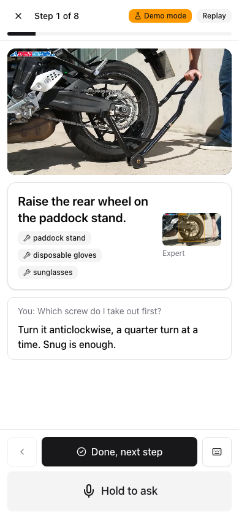

# Veteran's Eyes

**A senior records a repair once. Every junior after that gets their eyes.**

Veteran's Eyes turns one narrated expert video into a step-by-step guide with the exact parts
highlighted, then coaches a junior through the same job, live, by voice on a phone. It speaks each
step, answers spoken questions with the expert's own tips, and checks the junior's work at critical
steps before they move on.

Built for the **Meta Global AI Developer Hackathon 2026**, indie track, theme **Push the Frontier**:
four Meta models give a phone a new capability: watching an expert once, then seeing, listening to
and checking a beginner in the real world.

- **Demo video (3 min):** linked in the hackathon submission : [LINK](https://drive.google.com/file/d/1Kz_EUfKa0LN0yZUGJYv1PGTaea8bDyA9/view?usp=sharing)
- **Real-world test:** I had never cleaned a motorcycle chain. I cleaned my TVS Ronin's chain with only this app guiding me.



---

## Run it in 5 minutes

You can run everything **without an API key**: the app starts in **demo mode**, labelled on every
screen, with canned model answers, so every screen and flow can be tried for free. Add a Meta Model
API key for real answers.

### Option A: Docker (simplest)

Needs only [Docker](https://docs.docker.com/get-docker/).

```bash
git clone https://github.com/therealshai/veterans-eyes.git
cd veterans-eyes
docker build -t veterans-eyes .
docker run --rm -p 8000:8000 veterans-eyes                      # demo mode, no key
```

Open **http://localhost:8000**. A sample guide ("Clean and lubricate the motorcycle chain") is ready.

With your key, for real model calls:

```bash
cp .env.example .env            # then open .env and paste your key after META_API_KEY=
docker run --rm -p 8000:8000 --env-file .env veterans-eyes
```

### Option B: Run locally (macOS, Linux, Windows)

Needs **Python 3.11+**, **Node.js 20.19+ or 22.12+**, and **ffmpeg** (used to read uploaded videos).

| Tool | macOS | Ubuntu / Debian | Windows |
|---|---|---|---|
| Python 3.11+ | `brew install python@3.12` | `sudo apt install python3 python3-venv` | [python.org](https://www.python.org/downloads/) |
| Node 22 | `brew install node@22` | [nodejs.org](https://nodejs.org/) | [nodejs.org](https://nodejs.org/) |
| ffmpeg | `brew install ffmpeg` | `sudo apt install ffmpeg` | `winget install ffmpeg` |

Check them: `python3 --version`, `node --version`, `ffmpeg -version`.

```bash
git clone https://github.com/therealshai/veterans-eyes.git
cd veterans-eyes

# 1. API key (optional: leave it empty for demo mode)
cp .env.example .env

# 2. Python backend, in a virtual environment
python3 -m venv .venv
source .venv/bin/activate              # Windows: .venv\Scripts\activate
pip install -r requirements.txt

# 3. Build the web app (served by the backend, so there is one server)
cd frontend
npm ci
npm run build
cd ..

# 4. Start
uvicorn backend.app:app --host 0.0.0.0 --port 8000
```

Open **http://localhost:8000**. You should see the sample guide, and a **Demo mode** label if no key is set.

### Try it

1. **Coach:** on the sample guide, press **Start coaching**, then **Replay the expert's video**.
   A recorded video stands in for the camera: each step is spoken, **Hold to ask** answers by voice
   (or tap the keyboard icon to type), and **Check my work** checks critical steps.
2. **Review:** open **Review** to see each step's highlighted keyframe and edit what the AI wrote.
3. **New guide:** upload your own narrated repair video (MP4/MOV). With a key, Muse Wonder writes the
   guide and SAM 3.1 highlights the parts, in about 2–3 minutes for an 8-minute video.

### On a phone (camera and microphone)

Browsers only allow the camera and microphone over **HTTPS**. To test on your phone, expose the
local server with a free Cloudflare quick tunnel:

```bash
# macOS: brew install cloudflared · other systems: https://developers.cloudflare.com/cloudflare-one/connections/connect-networks/downloads/
cloudflared tunnel --url http://localhost:8000
```

Open the `https://….trycloudflare.com` link it prints on your phone and allow the camera and microphone.

### Troubleshooting

| Problem | Fix |
|---|---|
| `npm ci` fails or Vite complains about Node | Update Node to 22 (`node --version` must be 20.19+ or 22.12+) |
| `Could not read … as a video` on upload | Install ffmpeg, restart the server |
| Camera or mic doesn't open on the phone | Use the `https://` tunnel link, not `http://`; allow both permissions |
| Port 8000 is busy | `uvicorn backend.app:app --port 8001` and open :8001 |
| Answers look canned | That's demo mode: set `META_API_KEY` in `.env` and restart (`VE_FAKE=0` forces real calls) |

---

## How it works

```
 Senior's narrated video
        │
        ▼
 Muse Wonder ──► guide.json: steps with times, instruction, parts, tools,
        │        expert tips, warnings, which steps need a check (strict JSON)
        ▼
 SAM 3.1 ──► per step: find "hand" and the part in 5 sampled frames;
        │    keyframe = the moment the hand covers the part (highlighted)
        ▼
 Senior reviews and publishes in the web app
        │
        ▼
 Junior's phone (chest mount)
   ├─ each step spoken (browser speech)
   ├─ Hold to ask ─► Muse Voice Transcribe (realtime, via our backend) ─► Muse Spark: answer from
   │                 the step, the expert's tips and the current camera frame (~4 s)
   └─ Check my work ─► Muse Spark (expert keyframe vs junior frame)  ┐ in parallel
                       SAM 3.1 (find the part on the junior's camera) ┘ (~4 s)
                       → "matches" / "fix this" + what to change / "can't see clearly"
```

| Meta model | Job in Veteran's Eyes |
|---|---|
| **Muse Wonder** | Watches the expert video *with its audio* and returns the whole guide as strict JSON |
| **SAM 3.1** | Grounds parts in pixels: keyframe selection by hand–part contact; re-finds the part live on the junior's camera |
| **Muse Spark 1.3** | Live answers and checkpoint verdicts, minimal reasoning, about 4 s |
| **Muse Voice Transcribe** | Realtime push-to-talk speech, so hands stay on the job |
| **Muse Code** | Used to test and harden the build (found a mic resampling bug and a strict-schema bug, added end-to-end tests) |

### Technical highlights

- **Strict structured output end to end.** Pydantic defines the guide contract; its schema is
  flattened for strict mode and sent to Wonder. Invalid answers are retried once with the
  validation error fed back. Raw answers are saved first, so a parsing bug never costs a second call.
- **Keyframes by contact, not IoU.** A hand on a small bolt has near-zero IoU; we score the share of
  the part covered by the hand (`Box.covered_by`). If SAM finds nothing, Spark suggests simpler part
  names and SAM retries; otherwise the step is flagged for the senior to review.
- **A measured latency budget.** Spark with minimal reasoning dropped from 8.2 s to 3.9 s median.
  Checks run Spark and SAM in parallel (4.0 s median). Speech is final 0.4 s after the junior
  stops talking; the speech socket opens on button press, so its 1.5 s connect overlaps with speaking.
- **Truncation-safe live calls.** The output cap includes hidden reasoning tokens, so incomplete
  replies are detected and retried with a larger cap; an answer is never spoken cut off mid-sentence.
- **Browser audio done right.** An AudioWorklet resamples the mic (44.1 or 48 kHz) to 24 kHz 16-bit
  PCM in 80 ms chunks; the API key never reaches the phone (the backend relays the WebSocket).
- **Phone-ready video.** Uploads in AV1/VP9/HEVC are transcoded to H.264 so replay works on any phone.
- **Testable without credits.** Every Meta call goes through one module (`backend/meta.py`), so the
  suites run on fakes: **68 backend tests (pytest), 25 frontend tests (vitest), and a Playwright
  end-to-end run** at phone size.

### Results

| What | Measured |
|---|---|
| 8-minute expert video → guide | 8 steps, 8 highlighted keyframes, about 2.5 min (Wonder + SAM) |
| Spoken answer | ~4 s median, every answer complete |
| Camera check | ~4 s median (Spark + SAM in parallel) |
| Real-world test | A first-timer cleaned a motorcycle chain with the app |
| Honesty | When a photo can't prove a step (e.g. a thin lube coat), it says "can't see clearly" instead of guessing |

Timing details: [`docs/speed_test.md`](docs/speed_test.md). Design decisions: [`docs/DECISIONS.md`](docs/DECISIONS.md).

---

## Repository layout

```
backend/
  app.py              FastAPI: REST routes, voice WebSocket, serves the built app
  models.py           guide contract (Pydantic) + strict-schema flattening
  meta.py             the only module that calls Meta's API (Wonder, Spark, SAM)
  expert/             video → guide (extract_guide.py) → keyframes (keyframes.py)
  live/               coach.py (ask + check), asr_relay.py (voice)
  eval/industreal.py  checkpoint accuracy on the IndustReal dataset
  fake.py             demo mode (canned answers when no key is set)
frontend/             Vite + React + TypeScript + Tailwind + shadcn/ui
demo/chain-clean/     sample guide shipped with the repo
docs/learn/           one short explainer per module (01–09)
tests/                pytest suites (all run without API calls)
scripts/              run_capture.sh, export_demo.py, e2e.mjs, speed_test.py
```

## Development

```bash
python -m pytest                                  # backend tests, no API calls
cd frontend && npm test && cd ..                  # frontend unit tests
npm install && npx playwright install chromium && npm run e2e   # end to end, demo mode
cd frontend && npm run dev                        # hot-reload UI on :5173 (proxies to :8000)

# Build a guide from the command line (needs a key)
bash scripts/run_capture.sh path/to/video.mp4 my-guide two-wheeler
```

## Credits and data

- Senior's video in the sample guide: **SPORTSBIKESHOP.co.uk**, *How to clean and lube your motorcycle chain*, <https://www.youtube.com/watch?v=mtxkoA-mz_U>, licensed **CC BY**.
- Accuracy test data: **IndustReal** (Schoonbeek et al., WACV 2024), Apache-2.0.
- Ego-Exo4D was used for internal development testing only; none of it is included in this repository.
- Problem statistic: Deloitte & The Manufacturing Institute, 2024: the US may need 3.8 million manufacturing workers by 2033, and 1.9 million of those jobs could go unfilled.

Built by **Syed Shaista Tabassum** ([@therealshai](https://github.com/therealshai)).
